<picture><source media="(max-width: 600px)" srcset="assets/hero-mobile.svg">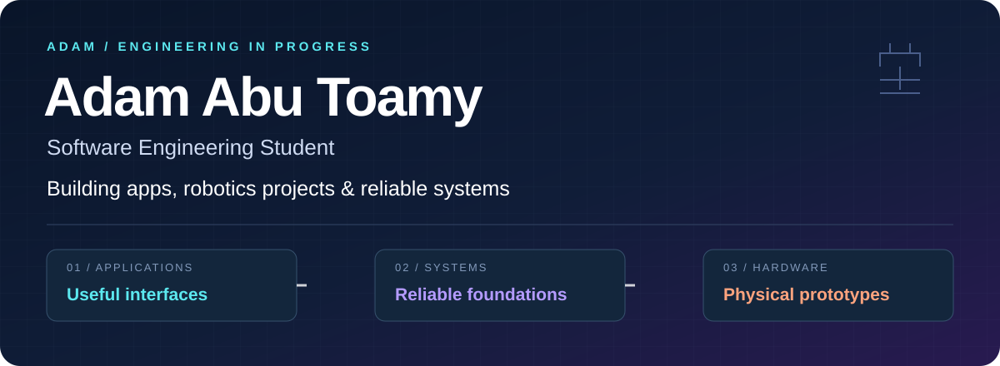</picture>

I build practical software and explore the hardware behind it. From a multilingual workspace to network protocols and servo-driven prototypes.

 

<!-- Live GitHub metrics; no fabricated contribution or language totals. -->
<h2 align="center">⌁ DEVELOPMENT TELEMETRY ⌁</h2>

GitHub-derived metrics · Automatically refreshed by the upstream card provider · Public activity

  

  
  

<b>✦ 3D CONTRIBUTION CITY · REAL ACTIVITY</b> — animated, refreshed by GitHub Actions

 

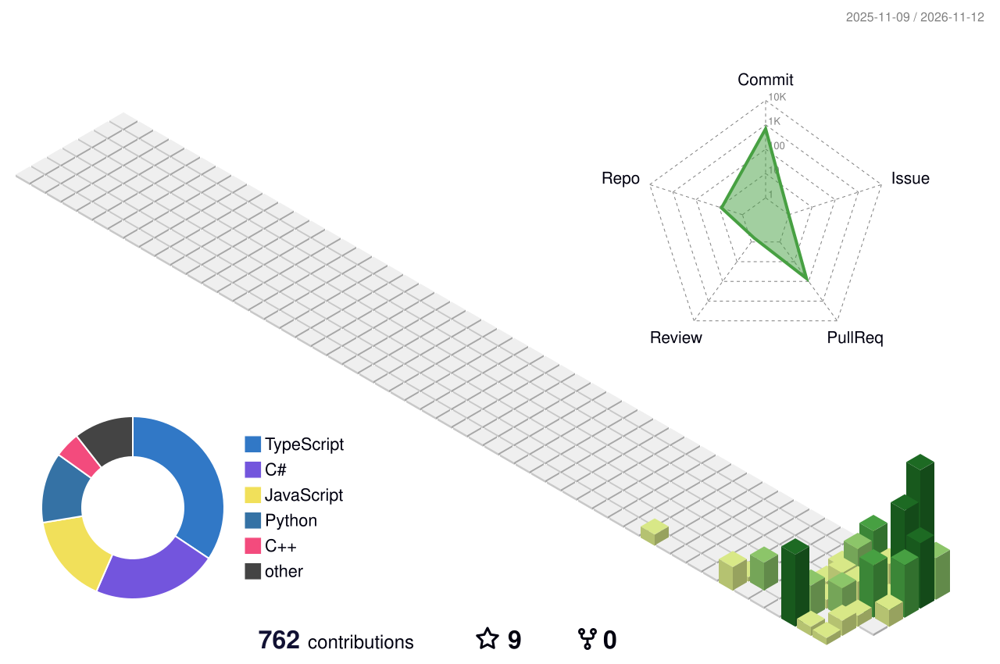

Generated daily from your actual contribution calendar. The image becomes available after the first successful <a href="https://github.com/AdamAbuToamy/AdamAbuToamy/actions/workflows/profile-3d.yml">3D workflow run</a>; it is not a live 3D browser canvas.

<h2 align="center">⌁ FEATURED REPOSITORIES ⌁</h2>

Original project media, compact previews, repository links · Select a card to explore the code

<table>
<tr>
<td width="50%" valign="top">
<a href="https://github.com/AdamAbuToamy/where-i-left-off">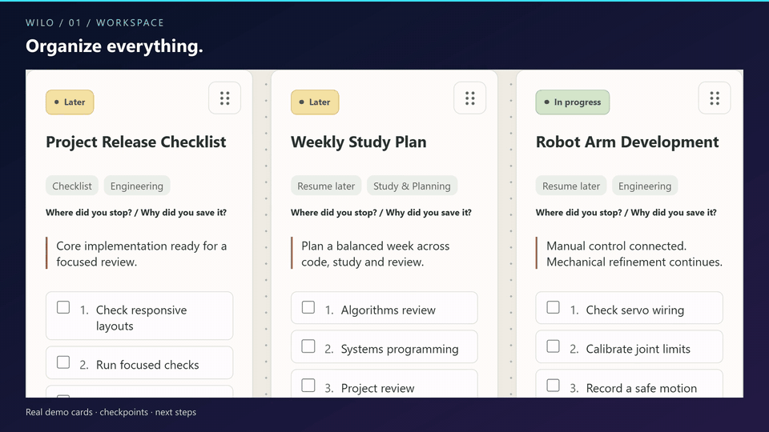</a> 
<strong>01 · <a href="https://github.com/AdamAbuToamy/where-i-left-off">WILO</a></strong>  
🗂️ Project & University Workspace 
React · TypeScript · Firebase 
<a href="https://where-i-left-off.web.app/">Live app</a> · <a href="https://github.com/AdamAbuToamy/where-i-left-off">Code</a>
</td>
<td width="50%" valign="top">
<a href="https://github.com/AdamAbuToamy/PostMark-ai-email-agent">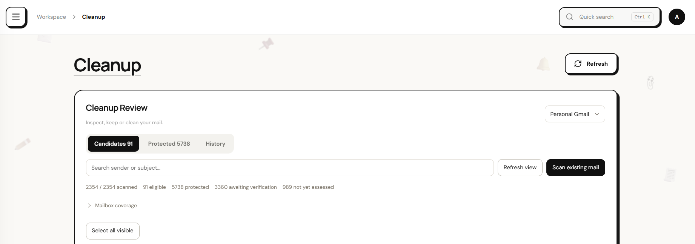</a> 
<strong>02 · <a href="https://github.com/AdamAbuToamy/PostMark-ai-email-agent">PostMark AI</a></strong>  
✉️ Multilingual Email Agent 
Python · FastAPI · React 
<a href="https://github.com/AdamAbuToamy/PostMark-ai-email-agent">Project & screenshots</a>
</td>
</tr>
<tr>
<td valign="top">
<a href="https://github.com/AdamAbuToamy/RobotArmStudio">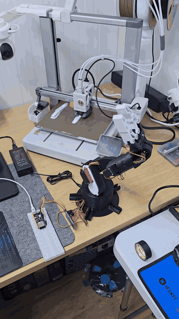</a> 
<strong>03 · <a href="https://github.com/AdamAbuToamy/RobotArmStudio">Robot Arm Studio</a></strong> 
🦾 Robotics · ESP32-S3 · Servos 
<a href="https://github.com/AdamAbuToamy/RobotArmStudio">Controller & build log</a>
</td>
<td valign="top">
<a href="https://github.com/AdamAbuToamy/FPV-Drone">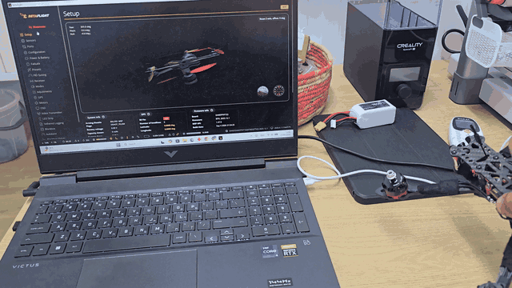</a> 
<strong>04 · <a href="https://github.com/AdamAbuToamy/FPV-Drone">FPV Drone</a></strong> 
🚁 FPV · Betaflight · Diagnostics 
<a href="https://github.com/AdamAbuToamy/FPV-Drone">Build & repair journal</a>
</td>
</tr>
<tr>
<td valign="top">
<a href="https://github.com/AdamAbuToamy/DeskPages">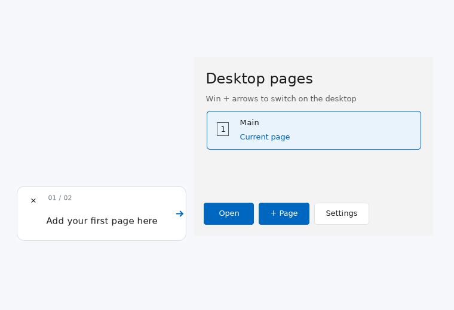</a> 
<strong>05 · <a href="https://github.com/AdamAbuToamy/DeskPages">DeskPages</a></strong> 
🖥️ C# · .NET · Windows desktop 
<a href="https://github.com/AdamAbuToamy/DeskPages">Explore source</a>
</td>
<td valign="top">
 
<strong>06 · <a href="https://github.com/AdamAbuToamy/stomp-emergency">STOMP Emergency</a></strong> 
⚡ Java · C++ · Networking · Concurrency 
<a href="https://github.com/AdamAbuToamy/stomp-emergency">Architecture & tests</a>
</td>
</tr>
<tr>
<td valign="top">
 
<strong>07 · <a href="https://github.com/AdamAbuToamy/kanban-backend-csharp">Kanban Backend</a></strong> 
📋 C# · .NET · Domain & business logic 
<a href="https://github.com/AdamAbuToamy/kanban-backend-csharp">Code & tests</a>
</td>
<td valign="top">
 
<strong>08 · <a href="https://github.com/AdamAbuToamy?tab=repositories">All Repositories</a></strong> 
⌘ University · Engineering · Experiments 
<a href="https://github.com/AdamAbuToamy?tab=repositories">Explore complete collection</a>
</td>
</tr>
</table>

<b>▣ More live analytics</b> — commit languages & productive time

 

---

<h2 align="center">PROJECT DEEP DIVES</h2>

Original real captures, architecture notes, working status, credits and source links remain below.

<picture><source media="(max-width: 600px)" srcset="assets/wilo-section-mobile.svg"></picture>

### A workspace that remembers the next step.

**[WILO — Where I Left Off](https://github.com/AdamAbuToamy/where-i-left-off)** brings projects, study plans, links, checkpoints and checklists together in Arabic, Hebrew and English. Built with **React · TypeScript · Firebase**.

**[▶ Full HD UI film — open / download](assets/wilo-showcase.mp4)** · **[Launch WILO ↗](https://where-i-left-off.web.app/)** · **[Explore the source](https://github.com/AdamAbuToamy/where-i-left-off)**

<b>Inside the real interface — workspace, cards, sessions & mobile</b>

Captured directly from the live app with fictional demo content. Cropped to keep account details private.

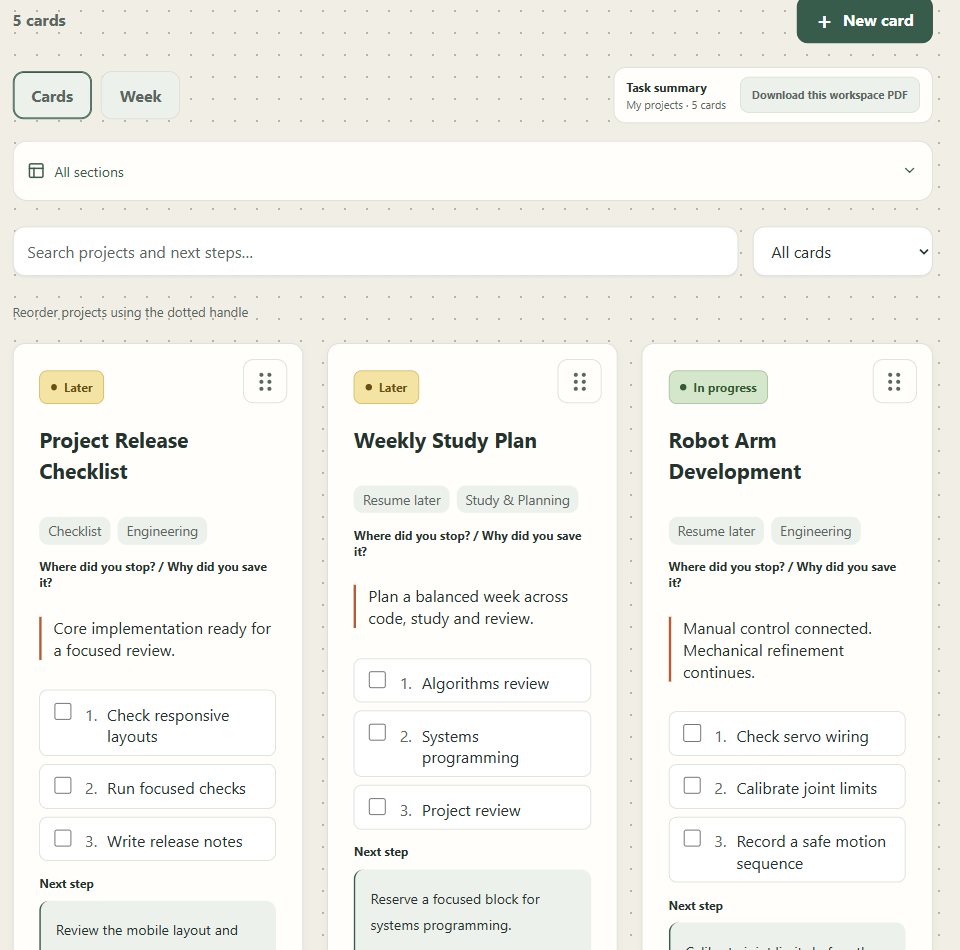
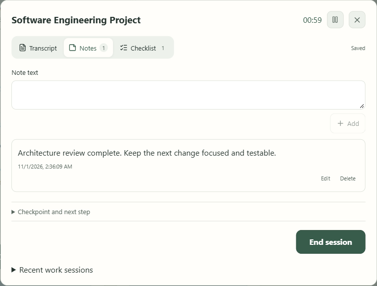

<a href="assets/wilo-create.png">Card creation</a> · <a href="assets/wilo-card.png">Checkpoint & checklist</a> · <a href="assets/wilo-mobile.png">390 px mobile capture</a>

**Engineering focus:** account-scoped persistence, offline edits, explicit conflict handling, and validated review-before-apply assistant proposals.

The film is a real browser walkthrough of the workspace, card creation, weekly view and work sessions. University and AI execution were excluded: the test account's unverified email blocks access. Voice recognition was not tested. [Capture notes & media provenance](assets/SOURCES.md).

 

<picture><source media="(max-width: 600px)" srcset="assets/postmark-section-mobile.svg"></picture>

### Email organization, with a recovery path.

**[PostMark — AI Email Agent](https://github.com/AdamAbuToamy/PostMark-ai-email-agent)** is a self-hosted email organization project for **Arabic, Hebrew and English**, combining account-aware AI routing, durable background jobs and recoverable automation.

**Python · FastAPI · React · TypeScript · SQLite WAL · Gmail API · Ollama**

- Organizes messages into meaningful categories while keeping document subtype and workflow status separate.
- Routes inference across cloud providers and local Ollama, respecting provider capabilities and limits.
- Tracks background sync, retries and recovery, with audit/rollback and permission checks for irreversible actions.

**Work in progress.** Accuracy evaluation, unattended reliability, packaging and security review remain ongoing. The public repository currently contains documentation and real application screenshots; **application source code is not yet published**.

[**Explore PostMark ↗**](https://github.com/AdamAbuToamy/PostMark-ai-email-agent) · [Real interface gallery](https://github.com/AdamAbuToamy/PostMark-ai-email-agent#real-application-screenshots)

Actual interface capture supplied in the project repository. Preview cropped above message records to avoid displaying email contents. Features and stack follow the project's documentation; no new runtime or accuracy test is claimed.

 

<picture><source media="(max-width: 600px)" srcset="assets/hardware-section-mobile.svg"></picture>

### Robot Arm Studio · From servo commands to physical motion

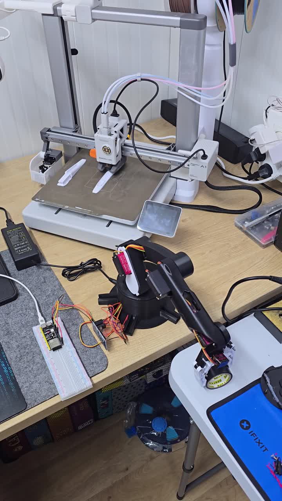 

**3D-printed arm · ESP32-S3 · PCA9685 · Servo control**

Assembly, electronics integration and a browser controller with manual control, calibration and saved motion sequences. **Work in progress:** mechanical refinement, calibration and physical validation continue. Software capabilities do not establish measured hardware accuracy.

[**Controller & build log ↗**](https://github.com/AdamAbuToamy/RobotArmStudio) · [▶ Assembled arm — full recording](assets/robot-assembled.mp4)

Mechanical base design purchased from [FABRI_CREATOR on Cults3D](https://cults3d.com/en/3d-model/gadget/brazo-robotico-con-arduino-step-files-robotic-arm-guardar-reproducir-export). Adam's work covers assembly, selected adaptations, electronics and controller integration. [Attribution](https://github.com/AdamAbuToamy/RobotArmStudio/blob/main/ATTRIBUTION.md).

### FPV Drone · Build. Diagnose. Repair.

**[▶ Betaflight orientation check — full recording](assets/drone-betaflight.mp4)** · [Build photograph](assets/drone-build.jpg)

**5-inch quadcopter · Betaflight · Wiring & soldering · ESC diagnosis**

A hands-on assembly and repair project: configuration, a hard-landing investigation, motor/ESC fault isolation and a reported MOSFET repair. **Work in progress:** current condition and repeatable flight performance remain to be documented.

[**Build & repair journal ↗**](https://github.com/AdamAbuToamy/FPV-Drone) · [Original photo gallery](https://github.com/AdamAbuToamy/FPV-Drone#photos) · [Repair log](https://github.com/AdamAbuToamy/FPV-Drone/blob/main/docs/REPAIR_LOG.md)

Betaflight is third-party firmware. No measured range, flight time or flight-readiness claim is made.

 

<picture><source media="(max-width: 600px)" srcset="assets/desktop-section-mobile.svg"></picture>

### One desktop. Separate spaces.

**[DeskPages](https://github.com/AdamAbuToamy/DeskPages)** organizes Windows 11 desktop icons into pages while preserving their original file paths. **Alpha · C# · .NET · WinForms · PowerShell**.

 <a href="https://github.com/user-attachments/assets/1604baac-4e1b-4fa8-92d0-7a5c943df32d">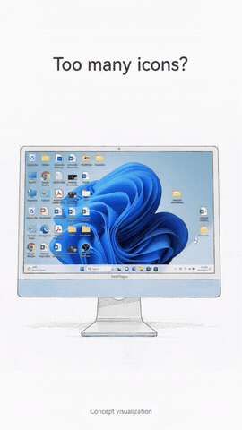</a>

[**Explore DeskPages ↗**](https://github.com/AdamAbuToamy/DeskPages) · [Alpha releases](https://github.com/AdamAbuToamy/DeskPages/releases) · [Full Concept Promo](https://github.com/user-attachments/assets/1604baac-4e1b-4fa8-92d0-7a5c943df32d)

Left: actual UI with fixture data under Mono/Xvfb; Windows fonts and borders may differ. Right: **AI-generated Concept Promo**, not evidence of implemented behavior. Physical Windows/touchpad acceptance remains pending in the source documentation.

 

<picture><source media="(max-width: 600px)" srcset="assets/software-section-mobile.svg"></picture>

### STOMP Emergency · Messaging & concurrency

**Java server · Multithreaded C++ client · TCP · Python integration tests**

An educational emergency-report simulation with thread-per-client and Reactor server modes, channel subscriptions, report summaries and a web incident workflow. Current work includes transport hardening and fault-injection scenarios.

[**Inspect the architecture ↗**](https://github.com/AdamAbuToamy/stomp-emergency) · [Test workflows](https://github.com/AdamAbuToamy/stomp-emergency/actions) · [Transport reliability](https://github.com/AdamAbuToamy/stomp-emergency/blob/main/docs/TRANSPORT_RELIABILITY.md)

Originally a Ben-Gurion University collaboration with **Ammar Mawassi**. An educational project; not an operational emergency service. Test evidence and its limits are recorded in the source repository.

### Kanban Backend · Rules before interfaces

**C# · .NET · Service / Business layers · Backend tests**

A university task-management backend for users, boards, columns and tasks, with state transitions, column limits and input validation.

[**Explore the backend ↗**](https://github.com/AdamAbuToamy/kanban-backend-csharp) · [Business layer](https://github.com/AdamAbuToamy/kanban-backend-csharp/tree/main/KanbanApp/Kanban_BackEnd/BusinessLayer)

 

<picture><source media="(max-width: 600px)" srcset="assets/stack-section-mobile.svg"></picture>

**Languages**   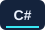    

**Frameworks**    

**Web**      

**Systems**     

**Hardware**    

**Developer Tools**     

Selected from the linked repositories' source and manifests. [Evidence map](assets/SOURCES.md#technology-evidence).

 

<picture><source media="(max-width: 600px)" srcset="assets/building-section-mobile.svg"></picture>

- **PostMark:** multilingual classification, reliable background work, inference efficiency and publication readiness.
- **WILO:** refining the live workspace, assistant boundaries and device verification.
- **Robot Arm Studio:** calibration, smoother movement, mechanical fit and physical validation. Camera/sensor integration remains planned.
- **FPV Drone:** ongoing tuning, simulator practice and documentation of the current build condition.
- **DeskPages:** Alpha development; physical Windows and touchpad acceptance remain open.
- **STOMP Emergency:** transport reliability, shared-state review and input/resource limits.

 

<picture><source media="(max-width: 600px)" srcset="assets/contact-section-mobile.svg"></picture>

<b>Follow the work as it develops.</b>  <a href="https://github.com/AdamAbuToamy">GitHub / AdamAbuToamy</a> &nbsp; · &nbsp; <a href="https://github.com/AdamAbuToamy?tab=repositories">All repositories</a> &nbsp; · &nbsp; <a href="https://where-i-left-off.web.app/">Try WILO ↗</a>

Real project media. Clear project status. Credit where it belongs. Profile visuals & captures refreshed November 2026.

