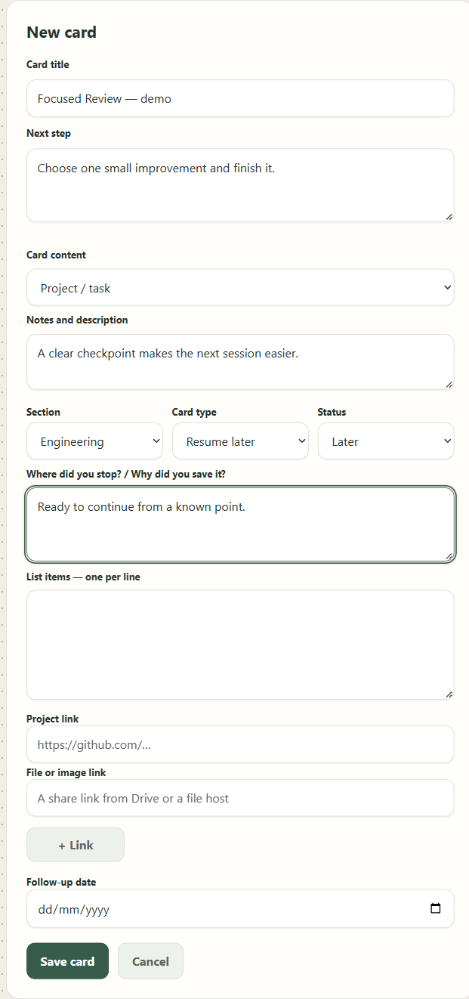
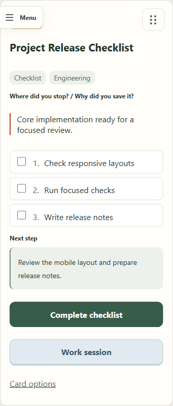
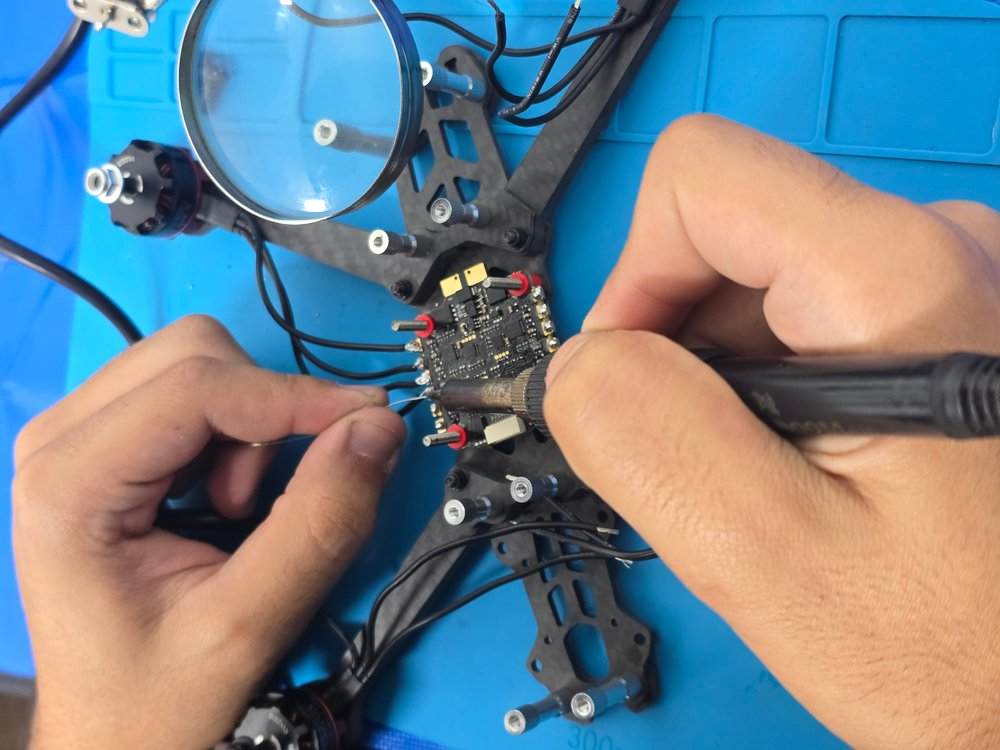
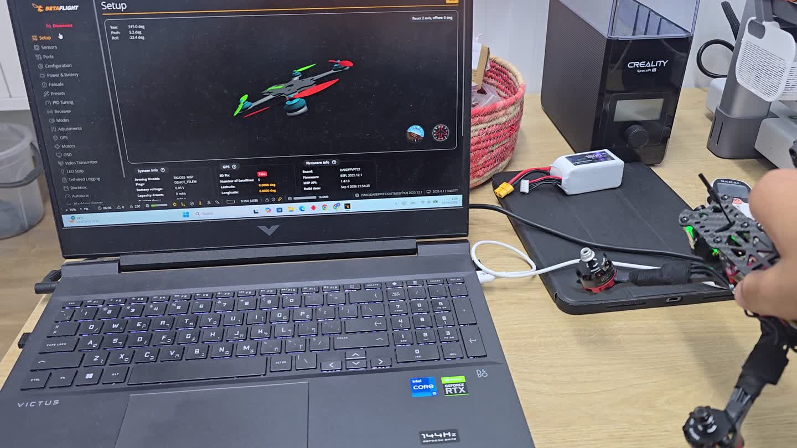
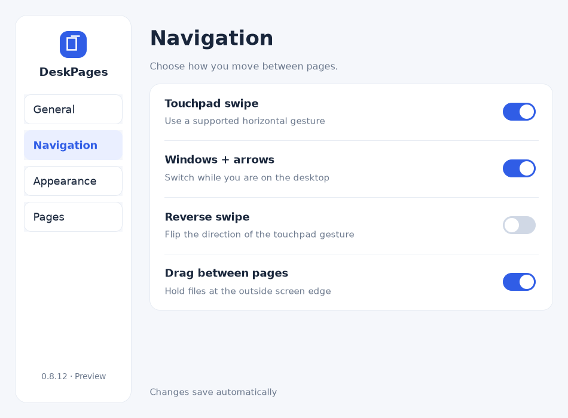
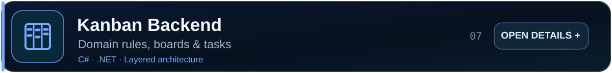

<!-- Recruiter-focused, lightweight GitHub profile. Project GIFs load only when expanded. -->
<picture><source media="(max-width: 600px)" srcset="assets/hero-mobile.svg"></picture>

<b>Software engineer building usable products, reliable systems and physical prototypes.</b>

 &nbsp;·&nbsp; 

## Featured Projects

Real engineering work · One project at a time · Open galleries for additional screens and demos

<h3>01 / LIVE PRODUCT · WILO</h3>
<table><tr>
<td width="38%" valign="middle"></td>
<td width="62%" valign="middle">
<strong>WILO</strong>

Project and university workspace with checkpoints, offline edits and account-scoped synchronization.

React · TypeScript · Firebase

 · 

</td>
</tr></table>

<b>View WILO gallery (4)</b>

<table><tr><td width="25%" valign="top">Workspace</td><td width="25%" valign="top">Card creation</td><td width="25%" valign="top">Work sessions</td><td width="25%" valign="top">Mobile view</td></tr></table>

<h3>02 / AI EMAIL AUTOMATION · PostMark AI</h3>
<table><tr>
<td width="38%" valign="middle"></td>
<td width="62%" valign="middle">
<strong>PostMark AI</strong>

Multilingual inbox organization with provider-aware AI routing and recoverable background jobs.

Python · FastAPI · React · SQLite

 · 

Work in progress.
</td>
</tr></table>

<b>View PostMark AI gallery (4)</b>

<table><tr><td width="25%" valign="top">Categories</td><td width="25%" valign="top">AI routes</td><td width="25%" valign="top">Cleanup</td><td width="25%" valign="top">Sync history</td></tr></table>

<h3>03 / ROBOTICS · Robot Arm Studio</h3>
<table><tr>
<td width="38%" valign="middle"></td>
<td width="62%" valign="middle">
<strong>Robot Arm Studio</strong>

Real assembled robotic arm with browser-based control, calibration and saved motion sequences.

ESP32-S3 · PCA9685 · Servo control

 · 

</td>
</tr></table>

<b>View Robot Arm Studio gallery (2)</b>

<table><tr><td width="33%" valign="top">Physical build</td><td width="33%" valign="top">Motion</td></tr></table>

<h3>04 / HARDWARE · FPV Drone</h3>
<table><tr>
<td width="38%" valign="middle"></td>
<td width="62%" valign="middle">
<strong>FPV Drone</strong>

Five-inch quadcopter build, fault investigation and real Betaflight orientation testing.

Betaflight · Wiring · ESC diagnostics

 · 

</td>
</tr></table>

<b>View FPV Drone gallery (3)</b>

<table><tr><td width="33%" valign="top">Build photo</td><td width="33%" valign="top">Betaflight frame</td><td width="33%" valign="top">Orientation test</td></tr></table>

<h3>05 / WINDOWS DESKTOP · DeskPages</h3>
<table><tr>
<td width="38%" valign="middle"></td>
<td width="62%" valign="middle">
<strong>DeskPages</strong>

Native desktop icon pages that preserve original file paths, with gesture and keyboard navigation.

C# · .NET · WinForms

 · 

Hero animation is an AI-generated concept; actual captured UI is in the gallery.
</td>
</tr></table>

<b>View DeskPages gallery (3)</b>

<table><tr><td width="33%" valign="top">Actual settings</td><td width="33%" valign="top">Actual UI tour</td><td width="33%" valign="top">Concept film</td></tr></table>

<h3>06 / NETWORKED SYSTEMS · STOMP Emergency</h3>
<table><tr>
<td width="38%" valign="middle"></td>
<td width="62%" valign="middle">
<strong>STOMP Emergency</strong>

Educational concurrent messaging system with Reactor mode, subscriptions and fault-injection tests.

Java · C++ · TCP/STOMP

 · 

University collaboration with Ammar Mawassi.
</td>
</tr></table>

<h3>07 / BACKEND · Kanban Backend</h3>
<table><tr>
<td width="38%" valign="middle"></td>
<td width="62%" valign="middle">
<strong>Kanban Backend</strong>

Task-management backend implementing state transitions, column capacity rules and input validation.

C# · .NET · Domain rules

 · 

</td>
</tr></table>

## GitHub Activity

Generated from real GitHub contributions. Activity metrics refresh using the repository workflow.

## Languages & Technologies

Python · TypeScript · JavaScript · C# · Java · C++ · React · FastAPI · .NET · Firebase · SQLite · Linux

<b>More GitHub statistics</b>

