<!-- Design: dark project panels inspired by the project-first structure of rahul-jha98, listed in MaxRohowsky/best-github-profile-readme. -->

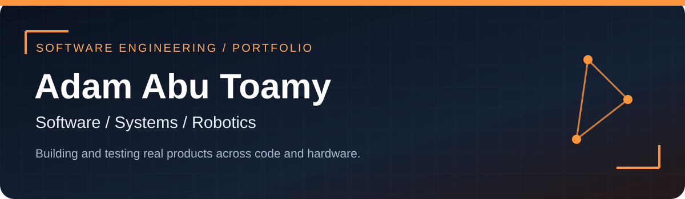

 &nbsp;  &nbsp; 

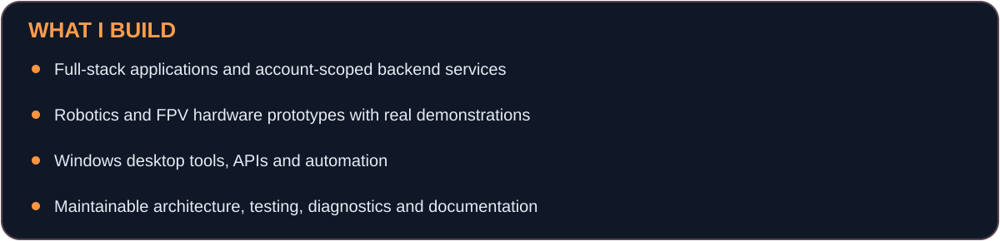

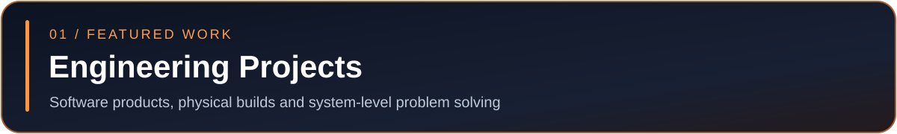

<!-- 01 / WEB PRODUCT : WILO — Where I Left Off -->

<a href="https://github.com/AdamAbuToamy/where-i-left-off">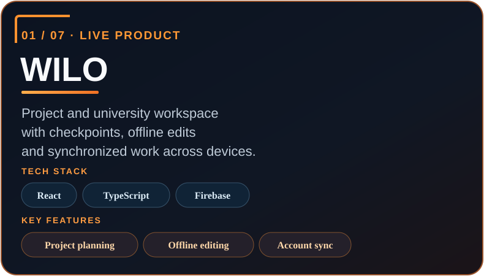</a>

<strong>A multilingual project and study workspace with synchronized data, offline editing and validated assistant actions.</strong>

 &nbsp; 

<!-- 02 / AUTOMATION : PostMark AI — Email Agent -->

<a href="https://github.com/AdamAbuToamy/PostMark-ai-email-agent">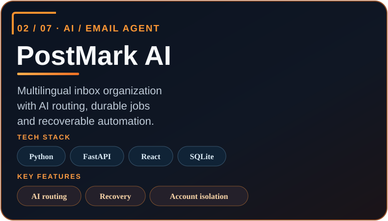</a>

<strong>An email organization system built around multi-account isolation, persistence, backend APIs and automated classification.</strong>

 &nbsp; 

<!-- 03 / ROBOTICS : Robot Arm Studio — Physical Robotics -->

<a href="https://github.com/AdamAbuToamy/RobotArmStudio">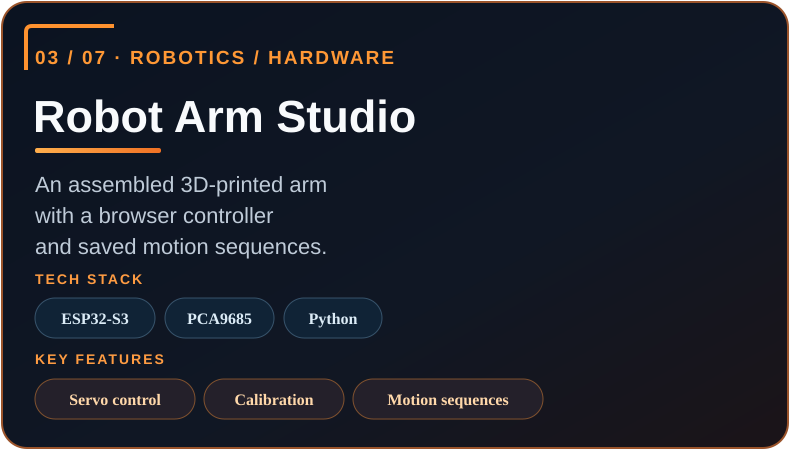</a>

<strong>A physical robotic-arm project demonstrating assembly and actual motion. A distinct example of work beyond web software.</strong>

 &nbsp; 

<!-- 04 / DRONE ENGINEERING : FPV Drone — Hardware & Flight Control -->

<a href="https://github.com/AdamAbuToamy/FPV-Drone">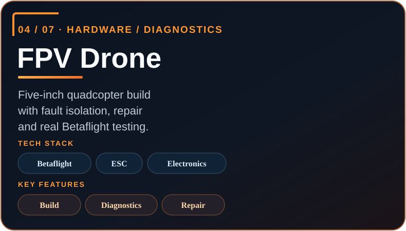</a>

<strong>FPV drone hardware build with documented Betaflight controller testing and orientation demonstrations.</strong>

 &nbsp; 

<!-- 05 / DESKTOP SYSTEMS : DeskPages — Windows Desktop Software -->

<a href="https://github.com/AdamAbuToamy/DeskPages">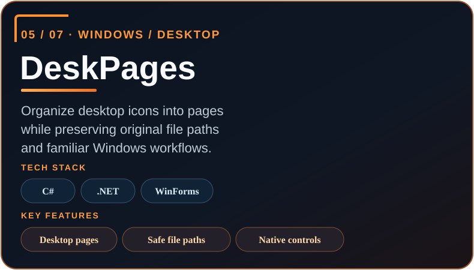</a>

<strong>A Windows desktop-page organizer that works with original desktop files. Published as alpha with documented limitations.</strong>

 &nbsp; 

<!-- 06 / NETWORKING : STOMP Emergency — Networked Systems -->

<a href="https://github.com/AdamAbuToamy/stomp-emergency">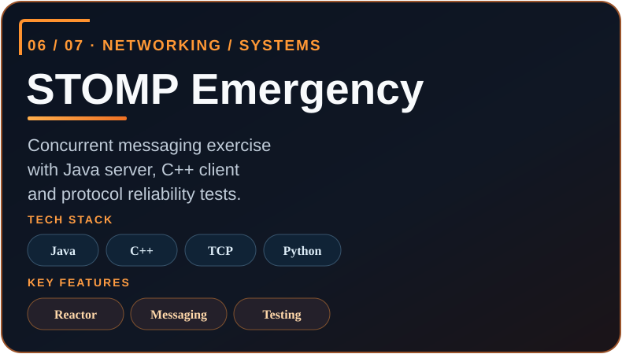</a>

<a href="https://github.com/AdamAbuToamy/stomp-emergency/actions">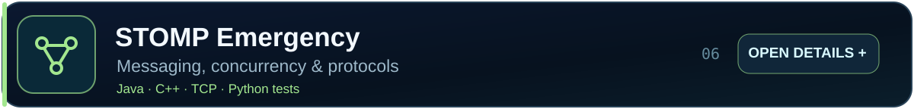</a>

<strong>A collaborative university project built around STOMP messaging and communication.</strong>

 &nbsp; 

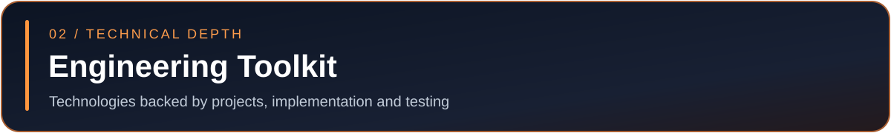

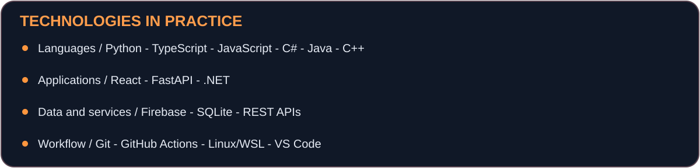

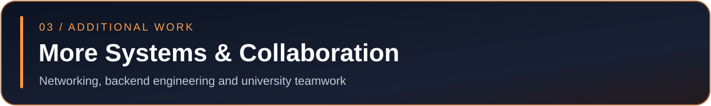

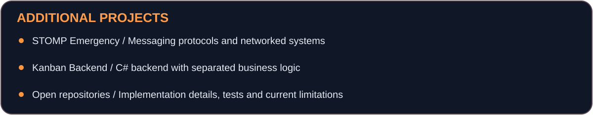

 &nbsp; 

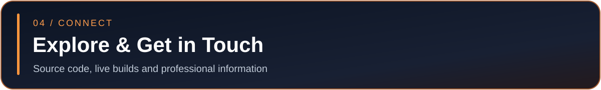

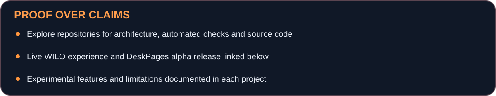

 &nbsp;  &nbsp; 

<b>Recent contribution activity</b>

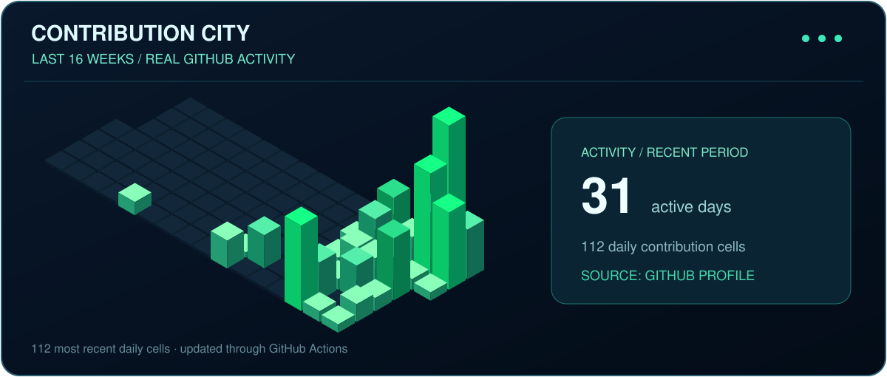

Layout inspired by <a href="https://github.com/rahul-jha98/rahul-jha98">Rahul Jha</a> in the <a href="https://github.com/MaxRohowsky/best-github-profile-readme">Best GitHub Profile README collection</a>. Visual assets and project descriptions reflect these repositories. GitHub controls its own page background; the dark panels are embedded artwork.
