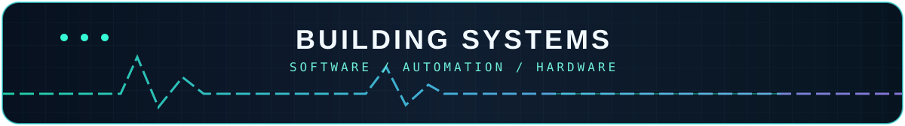

<!-- GitHub profile README. GitHub strips arbitrary CSS/JS, so expandable bars use native HTML details. -->
<picture>
  <source media="(max-width: 600px)" srcset="assets/hero-mobile.svg">
  
</picture>

<strong>SOFTWARE ENGINEERING · SYSTEMS · ROBOTICS</strong>

Building practical software, reliable backends, connected tools and physical prototypes.

 

---

<h2 align="center">⌁ GITHUB TELEMETRY ⌁</h2>

Data from public GitHub activity · Counts are generated by third-party stats services and may be cached

  

  
  

<h3 align="center">✦ 3D CONTRIBUTION CITY ✦</h3>

Recent 16 weeks · Real GitHub contribution data · Animated cyber 3D SVG · Daily refresh

<table>
<tr>
<td width="40%" align="center" valign="middle"></td>
<td width="60%" valign="top">
<strong>WILO</strong>

A multilingual workspace for projects, university courses, checkpoints and weekly planning.

⚙ React · TypeScript · Firebase

<a href="https://where-i-left-off.web.app/">Launch App</a>
</td>
</tr>
</table>

<strong>▸ MORE ABOUT WILO</strong> · engineering notes

The live app organizes project links, checkpoints, study plans, cards, and weekly schedules in Arabic, Hebrew and English. Its engineering focus includes account-scoped storage, offline edits, conflict handling, and assistant proposals that require review before applying.

<table>
<tr>
<td width="40%" align="center" valign="middle"></td>
<td width="60%" valign="top">
<strong>PostMark AI</strong>

An account-aware email agent for multilingual classification, sync recovery and safe automation.

⚙ Python · FastAPI · React · SQLite

<a href="https://github.com/AdamAbuToamy/PostMark-ai-email-agent#real-application-screenshots">Screenshots</a>
</td>
</tr>
</table>

<strong>▸ MORE ABOUT POSTMARK AI</strong> · engineering notes

A self-hosted project featuring provider-aware message classification, account isolation, durable background tasks, recovery paths and permissions for destructive actions. Work in progress: evaluation, packaging, reliability and security review remain unfinished; the application source is not yet publicly published.

<table>
<tr>
<td width="40%" align="center" valign="middle"></td>
<td width="60%" valign="top">
<strong>Robot Arm Studio</strong>

A physical 3D-printed robotic arm, servo controller and browser-driven motion sequencing.

⚙ ESP32-S3 · PCA9685 · Servos

<a href="https://github.com/AdamAbuToamy/AdamAbuToamy/blob/main/assets/robot-assembled.mp4">Full Video</a>
</td>
</tr>
</table>

<strong>▸ MORE ABOUT ROBOT ARM STUDIO</strong> · engineering notes

A physical 3D-printed arm with assembled servos, ESP32-S3, PCA9685, manual browser controls, calibration and saved movement sequences. The preview is genuine accelerated footage; mechanical refinement and measured performance validation are still ongoing.

<table>
<tr>
<td width="40%" align="center" valign="middle"></td>
<td width="60%" valign="top">
<strong>FPV Drone</strong>

A hands-on quadcopter project featuring assembly, configuration, diagnosis and electronics repair.

⚙ Betaflight · ESC · Soldering

<a href="https://github.com/AdamAbuToamy/AdamAbuToamy/blob/main/assets/drone-betaflight.mp4">Full Video</a>
</td>
</tr>
</table>

<strong>▸ MORE ABOUT FPV DRONE</strong> · engineering notes

A real 5-inch quadcopter build involving wiring, soldering, Betaflight setup, ESC/motor fault isolation and repairs. The preview demonstrates a recorded orientation test rather than proven flight readiness.

<table>
<tr>
<td width="40%" align="center" valign="middle"></td>
<td width="60%" valign="top">
<strong>DeskPages</strong>

Windows desktop icon organization into pages while preserving original file paths.

⚙ C# · .NET · WinForms

<a href="https://github.com/AdamAbuToamy/DeskPages/releases">Releases</a>
</td>
</tr>
</table>

<strong>▸ MORE ABOUT DESKPAGES</strong> · engineering notes

A Windows desktop organizer written with C#, .NET and WinForms. The project introduces multiple desktop icon pages without modifying original file locations. It remains in alpha; physical Windows/touchpad acceptance is being checked.

<table>
<tr>
<td width="40%" align="center" valign="middle"></td>
<td width="60%" valign="top">
<strong>STOMP Emergency</strong>

A Java server and multithreaded C++ client exploring STOMP messaging, concurrent workloads and tests.

⚙ Java · C++ · TCP · Python tests

<a href="https://github.com/AdamAbuToamy/stomp-emergency/actions">Test Runs</a>
</td>
</tr>
</table>

<strong>▸ MORE ABOUT STOMP EMERGENCY</strong> · engineering notes

A university messaging and concurrency exercise using a Java backend, multithreaded C++ client, TCP, subscriptions, Reactor and thread-per-client modes. Developed in collaboration with Ammar Mawassi; not an operational emergency-response service. No recorded product GIF is available.

<table>
<tr>
<td width="40%" align="center" valign="middle"></td>
<td width="60%" valign="top">
<strong>Kanban Backend</strong>

A layered C# task-management backend with domain validation, state transitions and business rules.

⚙ C# · .NET · Layered architecture

<a href="https://github.com/AdamAbuToamy/kanban-backend-csharp/tree/main/KanbanApp/Kanban_BackEnd/BusinessLayer">Architecture</a>
</td>
</tr>
</table>

<strong>▸ MORE ABOUT KANBAN BACKEND</strong> · engineering notes

A university C#/.NET backend for users, boards, columns and tasks, with layered business logic, column capacity constraints, input validation, state transitions, and backend tests. No recorded UI GIF is available.

---

<h2 align="center">⌁ TECHNOLOGY STACK ⌁</h2>

Languages · Frameworks · Systems · Tools

Also working with WinForms, ESP32-S3, servo hardware, TCP and STOMP. Technologies reflect the source repositories; the icons are not proficiency scores.

---

<h2 align="center">⌁ CURRENT WORK ⌁</h2>

PostMark reliability · WILO enhancements · Robot Arm calibration · FPV diagnostics · DeskPages alpha · STOMP transport hardening

<a href="https://github.com/AdamAbuToamy">GitHub</a> · <a href="https://where-i-left-off.web.app/">WILO</a> · <a href="https://github.com/AdamAbuToamy?tab=repositories">All Repositories</a>

Real projects · Real links · Dark cyber visuals · No invented activity counts

